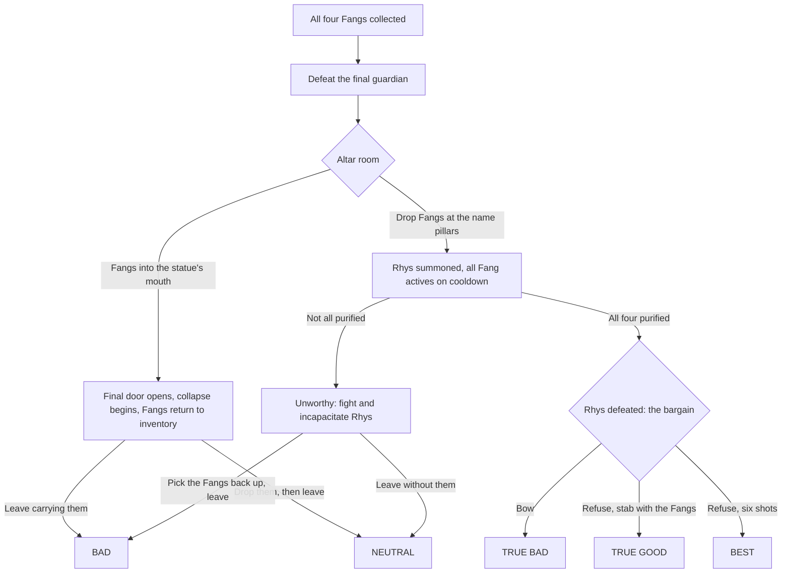

# The Temple of Rhys — Design Document v2

*Working title. Supersedes `design.md`, which stays in the repo as the raw idea log. Script art: `script.xcf`. Last updated 2026-10-15.*

## How to read this document

- **Plain text is decided.** It comes from `design.md` (where notes changed over time, the latest one wins) or from decisions made while drafting v2.
- **`> Proposal:`** blocks are suggestions that haven't been accepted yet. Accept, change, or cut them.
- *(assumed)* marks something the notes imply but never state outright.
- **Open:** items are unresolved. They are all collected again in §17.

---

## 1. Overview

**Pitch.** A robbed and stranded archaeology student has only one way out of a collapsed mountaintop: down, through the temple of a snake god. The quickest route out takes a few hours, and it damns them. The way to save the world is hidden in the temple's script, in its shape, and in its god's name.

| | |
|---|---|
| **Genre** | 2D side-scrolling metroidvania with Zelda-style dungeon puzzles |
| **Engine** | Godot (2D) |
| **Art** | Pixel art. Darkness and lighting carry the mood. |
| **Length** | 3–5 hours on the critical path (Bad ending); much longer for the full secret chain |
| **Core inspiration** | *Ocarina of Time*'s adult dungeons, for puzzle structure and theming |
| **Script inspiration** | *Tunic* |
| **Other touchstones** | *La-Mulana*: a great opening, but a weak second half, because almost all of its late-game items exist only to open doors. Pillar 5 is about avoiding that. Also *Metroid Prime* (scanning), *Castlevania* and *Indiana Jones* (the whip). |
| **Setting** | An unspecified jungle. The era is deliberately vague: a timeless, slightly anachronistic adventure setting. |

---

## 2. Design pillars

1. **Alone in a place you can't fully understand.** The temple is lonely, creepy, and ancient. You can explore it but never truly understand it. The professor's voice is your only company, and you can lose it.
2. **Never comfortable.** Every puzzle and enemy can be beaten, but fighting is always dangerous. Resources are scarce, and power upgrades are rare and hidden.
3. **Understanding is the real progression.** Items open doors, but *comprehension* opens endings. A player who only collects things escapes with the Bad ending. Reading the script, keeping the map, and listening to the lore lead to the better ones.
4. **The temple wants to be solved.** The secrets are layered and fair, and each one points to the next. The script always appears in the player's own language.
5. **No single-use key items.** Small keys and boss keys are the only pure keys. Every other item earns its place in both combat and puzzles. This is the *La-Mulana* trap to avoid.

---

## 3. World & lore

### 3.1 Rhys
Rhys is an ancient, Lovecraftian snake deity with four fangs set in the roof of its mouth. Its full name is **Rhys'sthylceras**. You need the full name to summon Rhys, and you must summon it to destroy it.

### 3.2 The Fangs and the cycle
The four **Fangs of Rhys** are Knowledge, Power, Life, and Wealth. Together they make their bearer a long-lived, super-strong, all-knowing monarch with limitless wealth. Every bearer eventually goes mad with power. They turn their followers into a cult, build a new temple, and entomb themselves inside it as a last act of deference to Rhys.

Only **one temple exists at a time**; temples don't multiply. Once the bearer is entombed, the temple stays hidden for a long time before it reveals itself and the cycle starts again. The temple in this game is the tomb of the previous bearer.

*The v1 idea of a living temple that consumes organic matter and grows the Fangs has been dropped.*

### 3.3 The historical record
The professor delivers this over the course of the game (§5):
- Cults of Rhys have appeared throughout history, thousands of miles and hundreds of years apart.
- Every temple carries the same script. It looks like no known human language, yet every researcher who studies it finds it strangely easy to translate, wherever in the world they come from. This is the in-world explanation for the language swap (§14).
- The cults share symbols and religious practices across cultures.
- Everyone who has held the Fangs went mad with power and then disappeared.

### 3.4 The temple wants to be solved
The temple writes its script in whatever language its reader knows. It seems to *want* to be understood.

> **Proposal: why it wants that.** The cycle is Rhys's search for a worthy vassal. Bearers who never purify the Fangs are failed candidates: they sink into madness, build the next temple, and reset the test. A bearer who purifies all four Fangs and beats Rhys in combat is the person the cycle exists to find, which is why Rhys offers them the bargain (§6). On this reading, the True Bad ending is what the temple wanted all along, and its helpfulness is the bait.

### 3.5 The mountain and the Collapse
The temple is buried inside a small mountain deep in the jungle. Far below, a great supporting pillar gave way, and the peak fell inward and exposed the temple from above. The section the player enters, **the Collapse**, rested on that pillar and fell **intact**. Its rooms still work, but the whole section now sits lower than its original position. That displacement is central to the main puzzle (§12).

---

## 4. Characters

**The player character.** An archaeology PhD student working under a famous professor. University budgets are tight, but this is the opportunity of a lifetime, so the student pays their own way and goes alone. **Open:** name, appearance.

**The professor.** A famous academic at the university and the player's only lifeline, first by radio and later (possibly) by telepathy. Researches whatever the player finds and sends back lore, translations, and history. **Open:** name, personality.

**The bandits.** Treasure hunters who ambush the player, strip them of everything, and enter the temple first. The temple kills them one by one, and the player finds their bodies along with pieces of the stolen gear. **One bandit survives** and is met alive later. **Open:** who it is (the leader?), where the player meets them, and their role: mini-boss, cult convert, tragic encounter, or something else.

> **Proposal:** The survivor has claimed a Fang and is already slipping into madness, a preview of the Bad ending in miniature. Power fits best: strength, aggression, a fight. That makes the survivor the human boss of the Power region and keeps the fixed Fang order intact.

**The villagers.** They saw the peak collapse, investigated, and spread the word. Prologue only.

**The previous bearer.** Entombed in this temple (§3.2), and the **final guardian**, fought just before the altar room: mummified, transformed, and still serving. It shows the player exactly where the Fangs lead.

---

## 5. Story & structure

### 5.1 Prologue (cutscene)
1. A jungle mountain's peak collapses. A nearby village sees it and investigates, and word spreads to the wider world.
2. The PhD student treks through the jungle for weeks, sets up a relay station for their radio at the summit, and rappels down into the chasm.
3. At the bottom are a few openings with rooms clearly visible behind them. Then bandits attack. They take everything (food, radio, notebook, weapons, climbing gear, even the student's shoes), knock the student out, and head into the temple.
4. The student wakes with nothing and no way to climb out. The only option is to enter the temple and hope to find the bandits and bargain with them.

*Era note: to fit the deliberately vague era, keep the tech chunky and non-specific: "the satellite relay," "the radio."*

### 5.2 Phases

| Phase | What happens | Story/lore |
|---|---|---|
| **1. The Collapse** | A nonlinear opening with several entrances. Recover the boots (from a dead bandit), the notebook, the radio, at least one weapon, the lantern, and the first climbing gear. Only the climbing gear is strictly required, but the layout should pull players toward everything. | Radio contact is restored. The professor explains the cult of Rhys and the four Fangs. With no other way out, the player sets out to collect them. |
| **2. Toward Knowledge** | The descent continues. The lantern's batteries die, then the radio's. The professor's last call reads out a translated cult rite involving bowing (an activation hint, §9.3). The player picks up the Knowledge Fang ("You feel your senses sharpen and your mind grow") and full vision returns. | Silence from here on, unless the player discovers the Fang's active. |
| **3–5. Power → Life → Wealth** | Fixed order. Each Fang's passive opens the way into the next region. | With telepathy: lore dumps, scanning, clues to the alternate dimension. Without it: no further story. |
| **6. Endgame** | All four Fangs, then the final guardian, then the altar room and the endings (§6). | |

### 5.3 Two ways through the same game
**Critical path (3–5 h):** collect the four Fangs, beat the guardian, put the Fangs in the statue's mouth, and leave. This ends in Bad or Neutral, and the player never had to understand anything.

**The secret chain:** each layer is gated by the one before it.

| # | Layer | Needs | Unlocks |
|---|---|---|---|
| 1 | Script literacy | Observation; the notebook | Wall texts, including how to activate Fangs |
| 2 | Fang actives | Layer 1, or the hints in §9.3 | Telepathy with the professor, scanning, Wealth duplication |
| 3 | Lore | Layer 2 | The full history; clues to the alternate dimension's entrances and to the name pillars |
| 4 | Alternate dimension | Layer 3, plus the Knowledge active at specific spots | Purification texts, weapon upgrades, optional areas and items |
| 5 | Purification | Layer 4, including reading foreign-language text | Purified Fangs, and with them Rhys's bargain |
| 6 | The full name | The complete map, plus spotting the Collapse offset | Summoning Rhys at the pillars |
| 7 | The gun | Climbing gear cloned with Wealth | The Best ending |

---

## 6. Endings

There are five endings, all decided in the altar room.

| Ending | How | Outcome |
|---|---|---|
| **Bad** | Leave carrying the Fangs | Rich, famous, and long-lived, until you go mad, found a cult, build the next temple of Rhys, and entomb yourself in it. The cycle continues. |
| **Neutral** | Leave without the Fangs | You escape the collapsing temple, and your fate is left **ambiguous**. Rhys is only buried: anyone could dig up the Fangs and restart the cycle. |
| **True Bad** | Purified Fangs → defeat Rhys → **bow** to accept the bargain | You become Rhys's vassal, the "final Emperor of Humanity," and plunge the world into darkness. |
| **True Good** | Purified → defeat Rhys → refuse → finish it with the four Fangs | The Fangs are destroyed, Rhys dies, and the temple spits you out at its exit. You escape with your life and nothing else, but the world is saved. |
| **Best** | Purified → defeat Rhys → refuse → **six shots** from the gun | Rhys is slain, and you keep the purified Fangs and use them to cure the world's ills. |

**Altar-room rules**
- **Statue route.** Putting the four Fangs in the statue's mouth opens the final door and starts the collapse timer, and the Fangs go back into your inventory automatically. To avoid the Bad ending you have to actively **drop** them (pause menu, Y) before you leave.
- **Summon route.** Dropping the four Fangs in front of the correct name pillars, in order, summons Rhys (§11.7). Every Fang active immediately goes on cooldown.
  - *Not all purified:* Rhys declares you unworthy and tries to kill you. You can incapacitate it and escape. **The defaults flip here:** your Fangs are still on the floor, so simply running gives Neutral, and getting Bad means deliberately picking them back up. Fighting Rhys therefore nudges players toward better endings without any extra effort.
  - *All four purified:* once you beat Rhys, it offers the bargain.
- **The gun ending needs all six rounds**, so you must beat Rhys **without firing the gun**. Summoning puts Wealth on cooldown, so you can't reload during the fight; reload before you summon. A line somewhere in the game should plant the idea: *"Enough bullets can kill anything."*
- *(assumed)* Incapacitating or defeating Rhys opens the final door and starts the collapse, just as the statue does.
- **Shooting an unpurified Rhys** doesn't kill it. Rhys mocks you instead. Working line: *"Hahaha, an unworthy mortal can never kill a god."*

**Open:** whether those shots still use up rounds; where "enough bullets can kill anything" appears and who says it; the final text and art for each ending.

---

## 7. Core gameplay

### 7.1 Moment to moment
2D side-scrolling exploration through an interconnected temple with item-gated progress. You descend floor by floor, solve room and region puzzles in the spirit of OoT's adult dungeons, and fight enemies that always feel dangerous.

**Movement verbs across the game:** run, jump, crouch/**bow**, crouch jump (jumping while crouched keeps you crouched in the air), drop through a one-way platform (hold down + jump), climb ropes, swim, double jump (Life Fang), dash (Quality Boots), grapple (Grappling Hook).

### 7.2 Controls & the pause menu
- The pause menu handles items: **A** selects, **B** uses, **Y** drops.
- Dropping is a real mechanic (it decides endings and works the pillars), not just inventory housekeeping.
- Fang activation is hidden inside this ordinary flow. A Fang's menu entry lists only **Drop**, but Use still works if you press it (§9.2).

### 7.3 Radio, then telepathy
- The professor sometimes calls right after you enter a room. **Time is paused while the radio is on**, so calls can't be exploited.
- The radio's batteries die before you reach the Knowledge Fang.
- Activating the Knowledge Fang opens a **permanent telepathic link** that replaces the radio. It also enables **scanning** in the style of *Metroid Prime*: you share what you see and hear with the professor, who researches it and comments. Scanning is the main way lore arrives after the radio dies.
- **Open:** scan input and UI.

### 7.4 The notebook
The notebook is required for "all sorts of information":
- **Map.** Starts when you recover the notebook and fills in automatically *(assumed)*. The god's name is read off the finished map (§12), so the map has to reproduce the temple's geometry faithfully.
- **Glyph glossary.** The notebook automatically records the glyphs and words the player has seen, and lets them write in their own guesses (as in *Chants of Sennaar*). This supports learning the script without the game ever handing over the key.
- **Lore log.** The professor's findings and transcribed wall texts.
- **Rope manager** (§8.3).

> **Proposal: custom pins and lines.** The player can place their own pins on the map and connect them with lines. This is the tool for drawing the name from landmarks (§12.3, method B).

### 7.5 Darkness
**Visibility falloff (current direction).** Close to the player, you see full shapes and colors. That fades quickly to fuzzy shapes (enemies become unanimated silhouettes; walls, floors, and objects show only partial outlines), then to black. The tuning target: players can always see enough to get around, but darkness stays a real obstacle.

The lantern lights dark areas until its batteries die just before the Knowledge Fang. That creates a stretch of limited vision, which the Fang's passive then fixes.

**Open:** the distance for each visibility band, and how the lantern changes them; whether there are dark areas earlier that need the lantern; whether the lantern has any other use.

### 7.6 Crushing and voiding out
Anything solid that moves can crush, such as a closing gate or a block. Whenever a moving solid pushes a character somewhere it can't move out of:
- **The player** is displaced to the nearest open spot and takes damage. If there is no open spot, they **void out**: they take the damage, the room reloads, and they reappear where they last entered it.
- **Enemies** are displaced and take damage the same way. If they can't be displaced, they die.
- **One-way platforms** count as solid for anyone standing on them. The only way down through one is an intentional drop: hold down and press jump. A moving solid pressing down on someone standing on one pushes them sideways, never down through.

---

## 8. Climbing gear

This is a signature system: a puzzle about managing ropes across the whole temple.

### 8.1 Rules
- The base game has **three** sets of climbing gear *(number pending)*.
- A rope can only be **placed from an anchor at the top** of a vertical shaft. That's why you can't climb out of the chasm, and why the only way forward is down.
- A placed rope runs to the bottom of its shaft and reaches **every exit along the way**.
- Once placed, a rope can be climbed both up and down *(assumed; implied by having to go back to the anchor to retrieve it)*.
- A rope stays until you retrieve it, and you can only retrieve it from its anchor.

### 8.2 The network puzzle
The core logistics puzzle is keeping access to the floors you've opened while freeing up ropes for deeper shafts. For example: rope 1 takes you from floor 1 to floor 2, and rope 2 from floor 2 to floor 3. Then you open a path from floor 1 to a shaft that reaches both floors 2 and 3. That frees a rope, which you retrieve and use to reach floor 4.

### 8.3 Rope manager (remote re-anchoring)
Players shouldn't spend hours backtracking just to move ropes. From the notebook map, you can **move any rope whose anchor you can currently reach on foot to any empty anchor you can also reach**, without walking there. The game tracks which floors are reachable and which ropes are accessible.

> **Proposal: a legality rule that rules out softlocks.** Allow a remote move only if the player could have made it on foot *and* could undo it:
> 1. the rope's current anchor is reachable from the player's position;
> 2. the target anchor is reachable from the current anchor *without* this rope;
> 3. after the move, the player's position still connects to the target anchor.
>
> Together these make every move reversible, so rope management can never strand the player. In code, this is a reachability graph: rooms are nodes, and the edges are walkable connections, placed ropes (two-way), and drops (one-way).

### 8.4 Wealth duplication
Using the Wealth Fang's active and then placing a rope restores your rope inventory, which effectively clones the rope you just placed. Extra ropes let you go deeper than the game "normally" allows, and this is the only way to reach the gun (§10).

---

## 9. The Fangs

The Fangs come in a **fixed order: Knowledge → Power → Life → Wealth**. Each has an obvious passive and a hidden active.

### 9.1 Abilities

| Fang | Passive | Active | Cooldown |
|---|---|---|---|
| **Knowledge** | Sharpened senses: full vision in the dark (replaces the dead lantern) | (1) First use: a permanent telepathic link to the professor, which also enables scanning. (2) At specific spots: travel to and from the alternate dimension. | None |
| **Power** | Double weapon damage; breaks certain walls; pushes certain large objects | Massive damage to every enemy in the room | Long (value TBD) |
| **Life** | Double jump; breathe underwater | Restores life force | TBD |
| **Wealth** | Reveals hidden caches | The next item you use gets its full inventory restored (clone a climbing gear, reload the gun) | ~10 minutes (placeholder) |

**Cooldown rules**
- Cooldowns run on **game time**: they don't tick while the pause menu or dialogue is open.
- Summoning Rhys puts **all** Fang actives on cooldown.
- Wealth is the gun's **only** source of reloads. Tune its cooldown so the player *can* clone climbing gear but has no incentive to waste bullets.
- **Wealth can't restore keys**, simply because keys have no Use action. The remaining logic gap isn't worth closing: once the player has Wealth, the game is nearly over and keys are rarely needed.

**Open:** cooldown values for Power, Life, and Wealth; what happens when the next item used after Wealth is another Fang. A Fang has no inventory to restore, so is Wealth's effect simply wasted, or does it reset that Fang's cooldown?

### 9.2 The activation ritual
The Fangs have no special menu, prompt, or tooltip. They activate like any other item, **followed by a bow**:

> Pause → select the Fang (A) → use it (B) → close the menu → **crouch immediately**. Any other action after closing the menu cancels the activation.

**Hidden in the menu.** A Fang's item menu shows only **Drop**, so players can always see how to drop it. Use is never listed, but pressing it still works.

A wall inscription spells the ritual out, so learning to read the script unlocks it. Thematically, every activation is a small act of deference to Rhys, and accepting Rhys's bargain at the end is also a bow.

**Open:** how long the window is between closing the menu and crouching.

### 9.3 Hints toward the actives
Missing the actives locks the player into the Bad or Neutral ending with no further story, so the game nudges more than once:
1. **The written rule** on a wall (requires reading the script).
2. **Bowing murals:** reliefs of cultists holding a Fang aloft, then bowing.
3. **The professor's last radio call:** just before the batteries die, the professor reads out a translated cult rite about raising the relic and bowing.

---

## 10. Items

Design rule: **no single-use key items.** Small keys and boss keys are the only pure keys, and climbing gear is a "key" you can move around. Every other item should be useful in both combat and puzzles.

**List status: semi-final.** It's enough for the game's scope, so there's no need to go looking for more items. It isn't frozen, though: an obvious good idea can still be added.

| Item | Function | Notes |
|---|---|---|
| **Ratty Boots** | Faster movement; slight protection from ground hazards | Found early, on a dead bandit |
| **Quality Boots** | Dash; better protection from hazards | Upgrade that replaces the Ratty Boots *(assumed)* |
| **Radio** | Contact with the professor; time pauses during calls | Batteries die before the Knowledge Fang |
| **Notebook** | Map, lore log, rope manager | Replaces v1's cartographer's tools |
| **Lantern** | Light | Batteries die before the Knowledge Fang |
| **Climbing Gear ×3** *(number pending)* | Descend shafts (§8) | Can be cloned with Wealth |
| **Whip** | Short-range melee, freely aimed; pulls distant levers; wraps round thin things (beams) and swings from them. Swing only: the player can't climb the whip, and jump lets go | Castlevania/Indy style |
| **Slingshot** | Long range, freely aimed, infinite ammo, low damage; hits distant switches | Recovered early |
| **Axe** | Strong melee; cuts ropes, vines, and wooden barricades | |
| **Wooden Darts** | Free-fired; faster than the slingshot and dead straight (no drop). One that flies through a flame such as a torch catches fire (like arrows in OoT) and sets what it hits alight. Ammo: 20, raised by upgrades | Refilled from certain enemies |
| **Explosive Charge** | First use places it at your feet; second use detonates it. Small blast that also hurts the player; for puzzles and damage. Ammo: 10, raised by upgrades | Recovered from certain enemies' remains |
| **Grappling Hook** | Free-fired; pulls you to an object or the object to you, depending on what it is; activates switches and levers | |
| **Gun** | 6 rounds total; 10× slingshot damage | Optional. Your own stolen gun, found at the very bottom of the temple via cloned ropes. Reloads only through Wealth. Required for the Best ending. |
| **Small keys / Boss keys** | Zelda-style keys | |
| **The four Fangs** | See §9 | |
| **Weapon upgrades** | Double damage for the axe, whip, and slingshot | Hidden in the alternate dimension |

**Hunger and food** are story flavor only (the bandits take your food in the prologue). They aren't a mechanic.

**Open:** whether the darts need a launcher (a blowgun?).

**Whip vs. hook (decided 2026-10-17):** they latch onto different things. The hook needs something wooden or soft to bite its barb into; the whip's end wraps round something thin, like a beam. Whether a thing takes one is its own flag, never tied to the other. The hook pulls; the whip only swings.

---

## 11. The Script of Rhys

The canonical glyph art is in `script.xcf`.

**Status: provisional (v0).** The overall system (phonetic, chained, paired consonants) is the intended direction. The individual glyph shapes are not final: they will be revised over several passes until the script passes the decipherability checks in §11.9.

**Chain notation used in this document:**
- `·` separates slots.
- `[X/Y]` is a stacked cluster, with X on top.
- `∅` is a deliberately empty half-slot.
- `_` is the underscore space.
- `'` and `|` are the null glyph in a consonant slot and a vowel slot respectively. They are the same character.

### 11.1 Principles
- **Phonetic.** The script spells sounds, not spellings: *safe* is S·e·F and *sword* is S·o·R·D.
- **Position is the rule.** A word is a chain of slots that alternate consonant and vowel: odd slots are consonants, even slots are vowels. Every word starts with a consonant slot, so a word that begins with a vowel sound starts with the null consonant (§11.2).
- **Clusters stack.** Two consonants can share one consonant slot. They are always stacked vertically within the slot, never placed side by side, so each horizontal step along a word is exactly one slot.
- **Orientation.** The base orientation is **right-to-left**. The **top-to-bottom** orientation is the same writing rotated 90° counterclockwise, so in it the cluster stacks appear side by side.
- **Two registers.** Connecting letters and mirroring consonants are stylistic choices, not grammar. Neither one changes what a word says.
  - **Plain (everyday writing).** Likely direction, not final: every letter, vowels included, stands on its own and is never mirrored. This is the canonical form of the script.
  - **Decorative (calligraphic).** The writer chooses to join letters into ligatures (shared stems, a connecting top stroke) and to mirror consonants so the whole looks good. Think of a monogram for someone's name, a shop sign, or a poem laid out for its shape. Every sample word in `script.xcf` is decorative.
  - Both registers obey the position rule and vertical-only cluster stacking.
  - **Where each is used.** The procedural composer prints the plain register for all generated text. A set of common sigils (*door*, *key*, *switch*, and so on) is converted into the decorative register for each language and loaded at runtime (§14.2).
- **Unambiguous.** Every rendered word must parse one way only. No glyph, cluster, or ligature join may look the same as a different combination of glyphs (§11.9).
- **Decipherable.** A determined player must be able to crack the script from a small number of in-world clues.
- **Aesthetic goal (decorative register):** "Rhys" should ideally read as a single unbroken, snake-like line. At minimum, it should look unmistakably like an ancient script. Where looks conflict with being unambiguous, being unambiguous wins for anything the player has to read in order to progress.

> **Proposal: hand-drawn proper nouns.** Fixed proper nouns, which never change with language, are hand-drawn decorative art: the god's name and its syllables, the "Rhys" sigil, cult marks. Because they're the same in every language, they only have to be drawn once and can be tuned by hand.

> **Proposal: decorative as a harder read.** The script is taught in plain text first. Decorative inscriptions appear later as a deliberately harder read, used for the temple's most important names and secrets. **Tension:** the common sigils (*door*, *switch*, …) are decorative, yet they're also the first clues players get (§11.8). Either pair the early sigils with a plain-text label, or accept a harder start.

**Open:** how lines wrap, and when each orientation is used.

### 11.2 Consonants
Consonants come in pairs. The second consonant of each pair is the first plus a **base stroke**.

| Pair | Base | + base stroke |
|---|---|---|
| 1 | S | Z |
| 2 | T | D |
| 3 | K | G |
| 4 | P | B |
| 5 | H | W |
| 6 | ' (**null consonant**; same glyph as the null vowel) | Y |
| 7 | R | L |
| 8 | F | V |
| 9 | N | M |
| 10 | Sh | J |
| 11 | Ch | Kh |
| 12 | **Th** *(new, to draw)* | **Dh** *(new, to draw)* |

### 11.3 Vowels

| Vowel | Sound | Shape |
|---|---|---|
| a | "ah" | up arrow (↑) |
| i | "ee" | bar over a ^ |
| u | "oo" | down arrow (↓), the mirror of a |
| e | "eh" | bar over a v, the mirror of i |
| o | "oh" | T |
| ai | "eye" | bar over a small hook |
| au | "ow" | larger double hook |
| \| | **null vowel**: short a/i/e | single vertical stroke (same glyph as the null consonant) |

- Sounds outside this set are built with consonants. For example, *ey* = e·Y, and *ua* = W·a (or u·W·a).
- **One null glyph, two roles.** The null consonant ' and the null vowel are the same character, and its slot decides which it is:
  - In a consonant slot, it's the null consonant, the placeholder that lets a word begin with a vowel sound: *over* = '·o·V·e·R.
  - In a vowel slot, it's the null vowel: *Rhys* = [R/H]·|·S.
- **The null vowel is never written at either end of a word.** A word-initial one takes its null consonant with it: *is* ('·|·Z) is written Z, and *the* (Dh·|) is written Dh. Inside a word it stays: *question* = [K/W]·e·[S/Ch]·|·N. A word that is nothing but the null vowel, such as *a*, keeps only its null consonant: a single vertical stroke, a one-glyph word like *is* = Z, and it takes the word breaks of §11.4 like any single consonant.

### 11.4 Spaces and punctuation

Word breaks are written with the slots themselves, using two marks:
- **Half-empty slot.** A single consonant takes only one half of its slot, as if a second consonant were coming. The other half is left completely empty, without even the null consonant.
- **Underscore space.** One empty slot with a horizontal line along the bottom.

| End of one word → start of the next | How the space is written | Pattern |
|---|---|---|
| Single consonant → consonant | The final consonant takes the **top half** of its slot, and the next word starts immediately after it | …[C/∅]·C… (*train tracks* = [T/R]·e·[N/∅]·[T/R]·a·[K/S]) |
| Cluster → single consonant | The space goes at the **start** of the next word: its first consonant takes the bottom half *(assumed: this is the "if necessary" case)* | …[C/C]·[∅/C]… |
| Cluster → cluster | An underscore slot between the words | …[C/C]·_·[C/C]… |
| Vowel → vowel | An underscore slot between the words | …V·_·V… |
| Consonant → vowel | An underscore slot, then the null consonant that starts the vowel-initial word | …C·_·'·V… (*Games over* = G·e·[M/S]·_·'·o·V·e·R) |
| Vowel → single consonant | The next word's first consonant takes the **bottom half** of its slot | …V·[∅/C]… (*to be* = T·u·[∅/B]·i) |
| Vowel → cluster | The null consonant fills the consonant slot after the vowel, then an underscore slot *(assumed: a cluster has no free half)* | …V·'·_·[C/C]… |

- **The position rule survives word breaks.** An underscore always fills the slot type the alternation needs. A half-empty slot marks where one word's chain ends and the next word's chain begins with its own consonant slot.
- **Implied size rule.** In a cluster, each consonant takes half the slot's height, and a lone consonant fills the whole slot. That size difference is what makes a half-empty slot readable as a word break.

**Open:** punctuation (sentence ends, pauses, numbers) isn't defined yet. The glyph printer also needs exactly one form per case. Does single consonant → single consonant always use the end-of-word half, as in *train tracks*? Should consonant → vowel ever use a half-empty slot instead of the underscore?

### 11.5 Sample words in `script.xcf`

All of these sketches are in the **decorative** register: their letters are connected, and some consonants are mirrored for looks (§11.1). In plain writing, the same words would appear as separate, unmirrored letters.

| Word | Chain |
|---|---|
| Door | D·o·R |
| Safe | S·e·F |
| Switch | [S/W]·\|·Ch *(reading of the sketch)* |
| Rhys | [R/H]·\|·S |
| Over *(example, not drawn)* | '·o·V·e·R, opening with the null consonant |
| Summon | drawn; chain not yet transcribed |
| *(unlabeled)* "chang" | Ch·e·[N/G]: a sound-drawing exercise, not a word. *Fang* (F·e·[N/G]) would look the same minus the inner vertical stroke that turns F into Ch. |

### 11.6 The god's name
**Rhys'sthylceras.** The "c" is soft (S), the "th" uses the new Th glyph, and each "y" is the null vowel.

- **Slots:** [R/H]·|·S·|·[S/Th]·|·[L/S]·e·R·a·S (11 slots). By the position rule, the apostrophe falls in a vowel slot, so it's the null vowel, the same glyph as each "y."
- **Pillar syllables** (four Fangs, four syllables): **Rhys' · sthyl · ce · ras**. As separate inscriptions they are [R/H]·|·S — [S/Th]·|·L — S·e — R·a·S (the apostrophe's null vowel is not written at the end of *Rhys'*, §11.3). Splitting the name this way divides the stacked [L/S] slot between *sthyl* and *ce*.

**Open:** the Th/Dh glyph design.

### 11.7 The name pillars
The altar room has pillars, each inscribed with a syllable, and there are more pillars than syllables *(assumed; the decoys are what make it a puzzle)*. Drop the four Fangs in front of the four correct pillars, **in order**, to summon Rhys.

**Which Fang goes in front of which pillar matters.** That forces players to actually learn the name instead of brute-forcing combinations.

> **Proposal:** Fang *n* goes in front of syllable *n* (Knowledge → Rhys', Power → sthyl, Life → ce, Wealth → ras). This ties the pillars to the region–syllable mapping in §12.3.

**Open:** what happens after a wrong arrangement. Nothing at all, or a cost that discourages trial and error?

### 11.8 How players learn it
Reading the script is a player skill, not an unlock. Because the script spells the player's own language phonetically (§14), learning it means cracking a substitution cipher with help from context. Single-word sigils sit beside what they name (*Door* over doors, *Switch* by switches, *Safe* on safes). Longer texts reward the effort with clues, prayers, history, and eventually the activation rule.

**Open:** the sigils are in the decorative register, which is the harder read, so should the first ones come with a plain-text label (§11.1)?

### 11.9 Readability & decipherability

The script only works as a puzzle if it can actually be deciphered, so its glyphs will be iterated against explicit checks.

**The failure case to design against.** An early version drew P as K with a vertical stroke closing the triangle. That shape was identical to the stacked cluster [Z/T], so P had to be redrawn. Any glyph that equals some combination of other glyphs has the same problem.

**Scope.** The checks target the **plain** register first: it's what the composer prints and what most in-world text uses. Decorative pieces are checked one at a time (rule 3).

**Rules**
1. **No collisions.** No single glyph may match any legal cluster (two consonants stacked in one slot). This applies to the base-stroke pairs too: adding a base stroke must never recreate another letter or cluster. The underscore space is also a line along the bottom, so it must never read as a neighbor's base stroke (S next to `_` must not look like Z).
2. **Slot boundaries and word breaks are always visible.** Position decides whether a glyph is a consonant or a vowel, and whether the null glyph is the null consonant or the null vowel, so a reader must always be able to count slots. A vertical stack inside one slot must never look like two slots, and two slots must never look like one stack. A half-empty slot must never be mistaken for a full-height single consonant, or the other way around.
3. **Decorative pieces stay readable.** Ligatures and mirroring may change how a word looks, but never what it says. A shared stroke must never hide a glyph or invent an extra one, and a mirrored consonant must never look like a different letter. This matters most for the null glyph, which is itself just a vertical stroke. Anything the player must read to progress has to be readable by someone who knows only the plain script.
4. **Survives pixel art.** Rules 1–3 must hold at in-game resolution, not just in the vector art. Near-collisions, where shapes differ by only a pixel or two, count as collisions.

**Process (expect several passes)**
1. **Glyph printer.** Build the procedural composer (§14.2) early, so any chain of sounds can be printed on demand in the plain register. Glyph shapes live in data (a stroke list per glyph), so redesigning a glyph is a data edit.
2. **Automated collision check.** Render every glyph, every legal cluster, every half-empty slot and underscore space, and every pair of adjacent slots. Compare them both as vector geometry and rasterized at game resolution, and report exact and near matches.
3. **Machine decipherment test.** Give an LLM (e.g., GPT-6) a page of rendered script plus only the clues a player would get, such as a few labeled single words (*Door*, *Switch*, *Safe*). Ask it to work out the sound values and translate held-out text. Record which glyphs it gets wrong and how many clues it needed. Run the test in more than one language, since the script has to work in every supported language.
   - *Caveat:* an LLM is a stand-in for a strong solver, not a typical player. It may be better than a person at frequency analysis and worse at reading images. Treat a model failure as a red flag, and a model success as necessary but not sufficient.
4. **Decorative review.** Check each decorative piece on its own, in every language it ships in: can someone (or the model) who knows only the plain alphabet still read it?
5. **Human playtest** with the in-game clue set, as the final check.
6. **Redesign the glyphs that fail, and repeat.**

**Open:** the minimum clue set the game provides (itself a design target); whether the decipherment test gives the model images or a structured stroke description; pass criteria for each round.

---

## 12. Temple layout & the name puzzle

### 12.1 The idea
The temple itself encodes **the god's full name in the script**, and the player reads it off the finished notebook map. The name is a proper noun, so it's the same in every language, and this puzzle doesn't change with localization. If the name has any disconnected pieces, some of them can only be found in the alternate dimension (§13).

### 12.2 The Collapse offset
When its supporting pillar gave way, the entry section (the Collapse) fell intact, so on the map it sits **one character position lower** than designed. To read the name, players have to understand how the script works and realize the Collapse needs to be shifted **up one position**. This is deliberate: the temple's damaged, no-longer-original layout is part of the main puzzle. The offset works with either drawing method below, because everything in the Collapse, whether rooms or landmarks, sits one position low.

### 12.3 Drawing the name

**The problem.** The map sits on a horizontal/vertical grid, but the script's strokes, especially the diagonals, don't translate cleanly to grid lines. It may be hard to make the floor plan itself spell the name without ambiguity. There are two candidate methods.

> **Proposal, method A: strokes become architecture.** Seen from the side, the script's shapes translate naturally:
> - **vertical stems → rope shafts** (most consonants have one)
> - **horizontal bars → corridors** (the top stroke that joins a ligature becomes a main hall)
> - **diagonals → stairs and ramps**
> - **vowel marks → small connecting chambers**
>
> The rope network (§8) and the name would then share one skeleton, with shafts as literal strokes. This is the method most exposed to the grid problem.

> **Proposal, method B: landmarks joined by poems.** Each region has a poem, written in the script, that names landmarks in order. For example, a text describes a scholar walking from the mother to the cleansing pool, and then to the golden room. The player finds the statue of a mother, the room with the cleansing pool, and the golden room, pins them on the map (§7.4), and connects them. The lines draw part of a character. Lines between pins can run at any angle, which avoids the grid problem. The poems are ordinary localized text, while the landmarks and the shape they draw are the same in every language.

> **Proposal: one syllable per region** (works with either method). Each Fang region forms one syllable of the name, read in the order you descend: Knowledge = Rhys', Power = sthyl, Life = ce, Wealth = ras. The Collapse sits in the first syllable. Players piece the name together one region at a time, and the pillar order (§11.7) matches the order in which they collected the Fangs.

**Open:** which method (or a mix); how much of the map must be drawn before the name becomes legible; with method B, whether the game recognizes a correct drawing or leaves it entirely to the player, and which landmarks and poem each region gets.

---

## 13. The alternate dimension

- **Crossing over, both ways:** use the Knowledge Fang's active at specific spots, to enter and to return. Lore and wall texts reveal the first spots.
- **The tell:** each crossing spot has a visual tell, and only reading the script teaches you what it means. After a few crossings, players should be able to walk into a new room and know whether they can cross there.
- **What's different:** it's the same temple, but the rooms **connect differently** and the monsters are much more powerful.
- **Script:** the same Rhys script, written in a **language this save has never been set to** (§14). Read as the player's own language, it's nonsense.
- **Contents:** the purification texts for all four Fangs; double-damage upgrades for the axe, whip, and slingshot; any disconnected pieces of the god's name (§12.1); other optional items and areas.
- **Purification:** each Fang is purified by an abstract ritual, along the lines of "use this item while equipping that one, in front of this statue." All four must be purified to reach the purified endings.

**Open:** how many crossing spots there are and what the tell looks like; the four purification rituals; whether a purified Fang looks or behaves differently.

---

## 14. Localization & the language swap (core pillar)

### 14.1 Rules
- All script text in the temple is in the **player's current language**, written phonetically in the Rhys script. Changing the language changes the glyphs on the walls immediately. In-world, the temple wants to be understood.
- Alternate-dimension text is in a language **this save has never been set to**. The save file records every language ever selected and picks one outside that set. For example, someone who has played in both English and Russian might get Mandarin.
- Proper nouns (Rhys'sthylceras and the pillar syllables) are fixed across languages, so the map and pillar puzzles work the same for everyone.
- **Design stance:** alternate-dimension text is foreign-language only, with no in-game cipher. Players are expected to transliterate it and then use real-world translation tools or community help. The best endings deliberately ask for effort outside the game.

### 14.2 Pipeline implications
Script text that changes with language can't be hand-painted art; it has to be generated:
1. Author each in-world text as a localized string key.
2. Translate it into each supported language (LLM-assisted, human-reviewed).
3. Convert each translation to phonemes (grapheme-to-phoneme).
4. Map those onto the Rhys sound inventory. This step is lossy: tone, vowel length, and missing consonants all have to be approximated.
5. Render the result with a **procedural glyph composer** that prints the plain register (§11.1): slot chains, stacked clusters, both orientations, at pixel-art scale. Bake per language at build time, or render at runtime.
6. Convert a set of common sigils (*switch*, *key*, *door*, and so on) into the decorative register, and save them to load at runtime. These words are localized, so every supported language needs its own set, and so does every language in the alternate-dimension pool.

### 14.3 Risks
- **Lossy transcription vs. translators.** Foreign text has to survive being squeezed into the Rhys inventory and then transliterated back by the player, with enough left for a translation tool to understand. *Recommendation:* draw alternate-dimension languages from a curated pool whose normal spelling is close to phonetic (e.g., Spanish, Italian, Indonesian, Swahili), keep the purification texts short and concrete, and playtest the full transliterate-then-translate loop.
- **Language-set edge cases.** If the player later switches to the current alternate-dimension language, pick a new one *(assumed)*. If the pool runs out, fall back to the least recently used language.
- **Pixel-art legibility and ambiguity.** Glyphs have to stay readable and parse one way only at low resolution, and so do decorative ligatures (§11.9).
- **Decorative sigils scale with languages.** Each language needs its own sigil set. Hand-drawing every set gets expensive as languages are added, while generating them means the computer has to make aesthetic choices.

---

## 15. Draft progression (strawman)

*This table exists to be argued with. Only the Fang order and the phase beats in §5 are decided.*

| # | Region | Way in | Finds | Ends with |
|---|---|---|---|---|
| 1 | The Collapse | Start | Ratty Boots, Notebook, Radio, Lantern, Slingshot, Climbing Gear 1 | First descent |
| 2 | Knowledge | Rope | Whip, Climbing Gear 2; lantern and radio die | Knowledge Fang |
| 3 | Power | Rope network | Axe, Explosive Charges | Power Fang *(the survivor?)* |
| 4 | Life | Power (breakable walls) | Grappling Hook, Climbing Gear 3; flooded areas | Life Fang |
| 5 | Wealth | Life (double jump, water) | Quality Boots, Wooden Darts | Wealth Fang |
| 6 | The Deep *(secret)* | Ropes cloned with Wealth | The Gun | |
| 7 | Guardian & Altar | All four Fangs | | Endings |
| — | Alternate dimension | Knowledge active at specific spots | Purification texts, weapon upgrades, optional items | |

**Scope guard:** the critical path stays at 3–5 hours. Depth comes from secrets, not from making the mandatory route longer.

---

## 16. Technical notes (Godot)

The systems this design implies, roughly from most to least risky:

1. **Glyph composer + localization pipeline** (§14). The most novel system and a core pillar, so prototype it first. It includes word-break spacing (§11.4) and the per-language decorative sigil sets. The composer doubles as the glyph printer for the decipherability work (§11.9), alongside an automated collision checker and an LLM decipherment harness.
2. **Rope network:** anchor and shaft data, the reachability graph, the remote-move legality check, and the map UI.
3. **Map ↔ name:** levels laid out against the name's geometry (method A) or landmarks placed so that pinned lines draw it (method B, §12.3). Either way, a notebook map faithful enough to read, plus a glyph glossary and custom pins and lines.
4. **Two-dimension world:** shared rooms with different connection graphs and enemy sets.
5. **Fang system:** passives; the hidden activation input (close menu → crouch within a window, cancelled by any other action); the hidden Use in the menu; cooldowns on game time that pause during menus and dialogue and persist through saves; and the reset on summoning.
6. **Dialogue, radio, and telepathy** with the world paused, plus **scan** mode.
7. **Player controller:** run, jump, double jump, dash, crouch/bow, rope climbing, swimming, aimed weapons, grapple.
8. **Lighting:** the visibility falloff (full detail → fuzzy silhouettes and outlines → black, §7.5), and the stretch of darkness before the Knowledge Fang.
9. **Save data:** progress, rope placements, cooldowns, every language ever selected, the current alternate-dimension language, purification state.
10. **Endings state machine** (§6).

---

## 17. Open questions

**Story & characters**
- Names, appearance, and personality of the player character and the professor.
- The surviving bandit: who, where, and in what role.
- Where "enough bullets can kill anything" appears, and who says it.
- Text and art for each ending.

**Systems**
- Fang cooldown values for Power, Life, and Wealth (Wealth's ~10 minutes is a placeholder).
- What happens if the next item used after Wealth is another Fang: is the effect wasted, or does it reset that Fang's cooldown?
- How long the activation window is.
- Scan input and UI.
- Whether shooting an unpurified Rhys uses up rounds.
- How many sets of climbing gear.
- Whether darts need a launcher.
- Darkness: the distance for each visibility band, and how the lantern changes them.
- Lantern uses beyond lighting dark areas, and whether earlier areas need it.
- Health, death, and saving: checkpoints, and what happens to placed ropes when you die.
- Whether the map fills in automatically or the player draws it.

**Script & name**
- Line wrapping, and when each orientation is used.
- Punctuation: sentence ends, pauses, numbers.
- Spacing edge cases: one printed form per word-break case (§11.4).
- Is plain writing fully unconnected, with vowels separate from consonants too?
- Decorative sigils: which words get one, and whether each language's set is hand-drawn or generated.
- Should the first sigils come with a plain-text label, since decorative writing is the harder read?
- The Th/Dh glyph design.
- The Fang-to-pillar mapping, and what happens after a wrong arrangement.
- The minimum clue set for deciphering the script, and the pass criteria for each round of checks (§11.9).

**World**
- How the name is drawn: floor plan (method A), landmarks and poems (method B), or a mix. With method B, does the game recognize a correct drawing, and which landmarks and poem does each region get?
- How much of the map is needed before the name becomes legible.
- The four purification rituals, and whether a purified Fang looks different.
- How many alternate-dimension crossing spots there are, and what the visual tell looks like.
- The region list, bosses, and enemy roster.
- Which languages ship at launch, and the alternate-dimension language pool.

---

## Appendix: what changed from design.md

| v1 idea | v2 status |
|---|---|
| The temple is a living creature that grows the artifacts | Dropped. One temple at a time; each bearer builds the next |
| A crater deep in the jungle | A collapsed mountain peak, witnessed by a village |
| Cartographer's tools | The notebook |
| The dungeon layout itself spells the god's name | Still the goal. It's drawn either by the layout or by pinning landmarks named in poems (§12.3) |
| Script: one character per consonant-vowel-consonant syllable | A phonetic chain script (§11) |
| 2D or 3D | 2D side-scrolling metroidvania |
| All four Fangs at the end of the temple | One Fang per region, in a fixed order |
| Good ending: drop the Fangs, die in the jungle | Neutral ending: fate left ambiguous |
| "Great" ending: summon and kill Rhys, die poor in the jungle | True Good: purify, defeat Rhys, stab it with the Fangs, escape with your life |
| Best ending: purified Fangs + pillars → keep the Fangs | Best: purify + defeat Rhys + six shots |
| The gun is "all but necessary" to kill Rhys | The gun is the alternative finishing blow; Rhys must be beaten without firing it |
| Alternate-dimension text hidden by a cipher | Foreign language only |
| A weak telepathic flicker on picking up the Fang (idea) | Not used. The hints are murals and the professor's last call |
